# tmux-rc

[Website & documentation](https://querystory.github.io/tmux-rc/)

Watch and control whatever runs in a tmux pane — AI coding agents like Codex, Claude
Code, Gemini CLI, OpenCode and omp, or any other program that prints text — from your
phone. A small local service reads a `tmux` pane, figures out what's happening, and
shows a phone-native dashboard: status at a glance, alerts when an agent is blocked on
a question, tappable answers, and a snapshot timeline.

- **Drive tmux from anywhere.** Every pane, any agent, from a phone or a browser: the live
  terminal, tappable answers to its questions, and the keys a phone keyboard lacks.
- **Talk to your fleet.** A plain-English summary of every pane, and a chat or voice
  conversation that relays your instructions and reports back
  ([Live Mode](docs/design/live-mode.md)).
- **Reboot without losing your fleet.** Sessions, windows, splits and names come back, and
  each agent resumes its own conversation, in one tap
  ([below](#reboot-without-losing-your-fleet)).
- **Review agents' work.** Where it happens: [Scratch](docs/scratch.md) pages are files on
  the machine your agents run on, with nothing to upload and no hosted, vendor-locked
  service. Artifacts for any model or harness: planning docs, drafts, mocks and reports, as
  HTML or in a Markdown viewer with tables, mermaid and callouts ([below](#review-agents-work)).

<p align="center">
  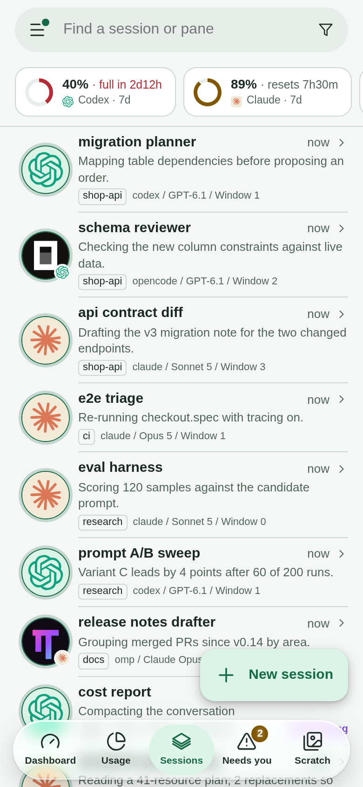
  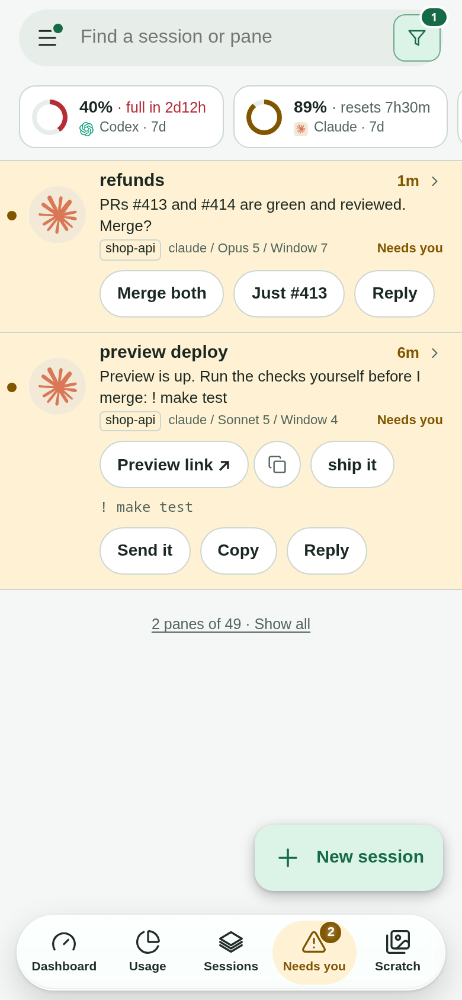
  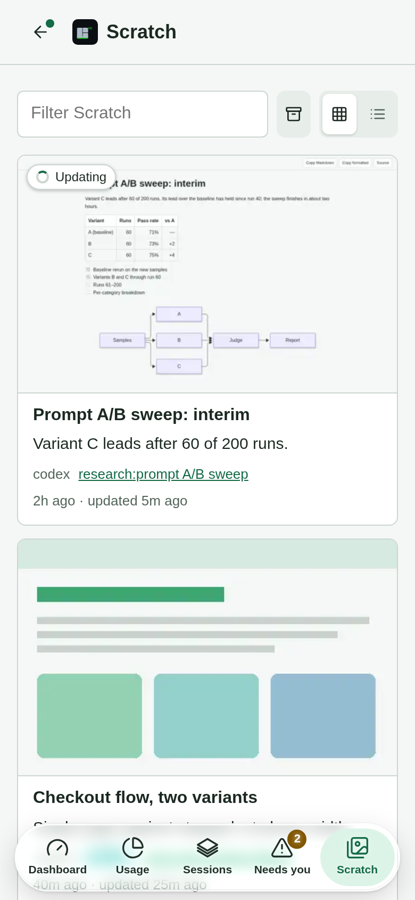
</p>

<p align="center"><em>Every agent at a glance, answers in one tap, and the pages they made.</em></p>

<p align="center">
  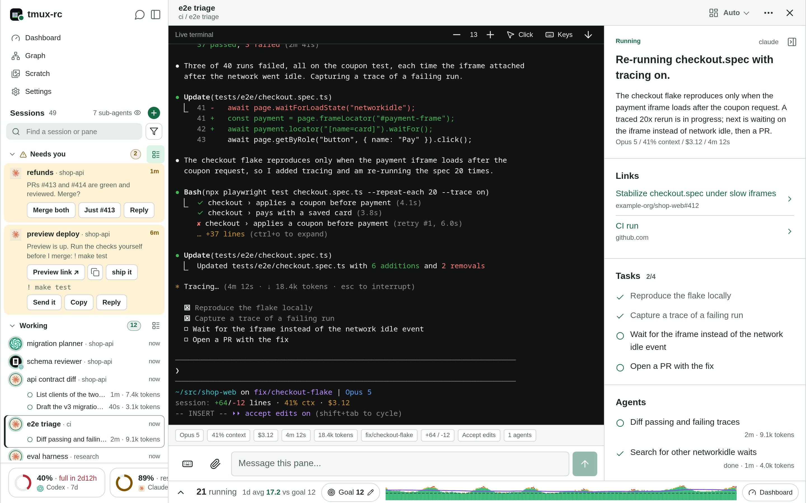
</p>

<p align="center">
  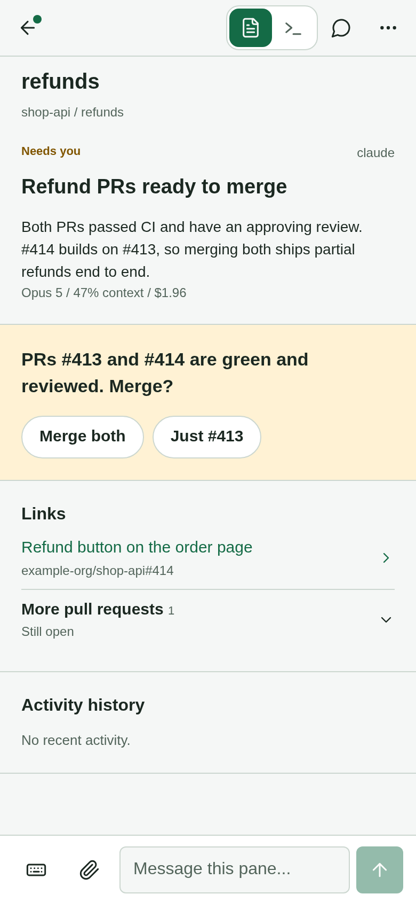
  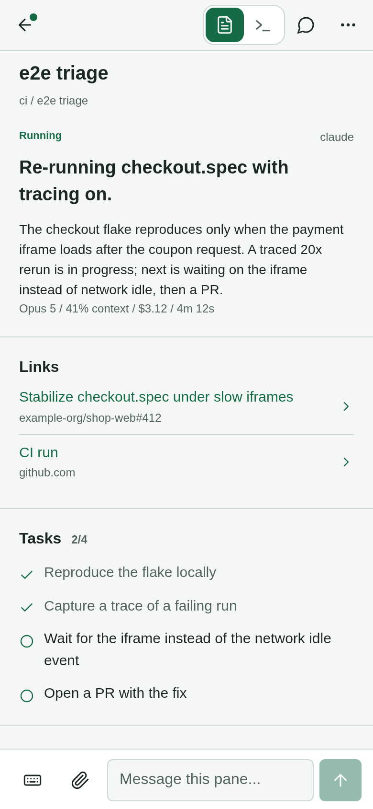
</p>

<p align="center"><em>Every screenshot here is the real UI rendering an invented fleet (<code>make screenshots</code>). The phone UI at <code>/m</code>. Left: every pane on the tmux server, grouped by state (Needs&nbsp;you, Working, Quota&nbsp;blocked, Just&nbsp;finished, Idle) or by session; the tab bar switches between Dashboard, Usage, Sessions, Needs&nbsp;you and Scratch, and the menu (☰) holds Chat, Voice and Settings. Right: one pane's Overview — what the agent is doing, and a composer to answer it.</em></p>

The Overview also lifts what the agent printed for you to use elsewhere: a commit
message, a command, a token, each under **From the terminal** with a **Copy** button. The
composer attaches any file from the phone, not only photos; the pane receives a path the
agent can open. Pane rows and places are links, so a middle or Ctrl-click opens one in a
new tab. Share a link from another app into a pane and the list asks which pane
([how](docs/iphone-setup.md#share-a-link-into-a-pane)).

<p align="center">
  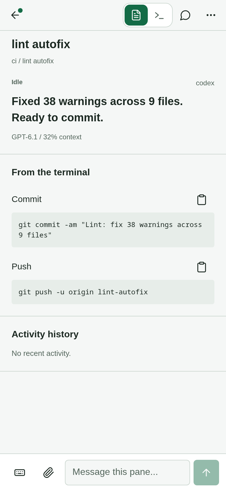
  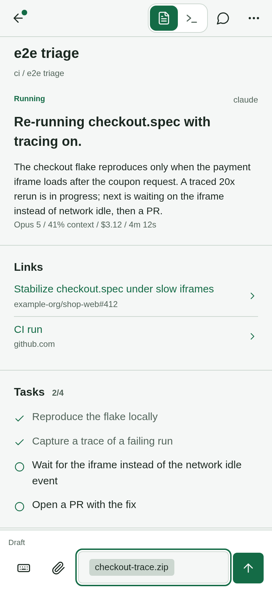
  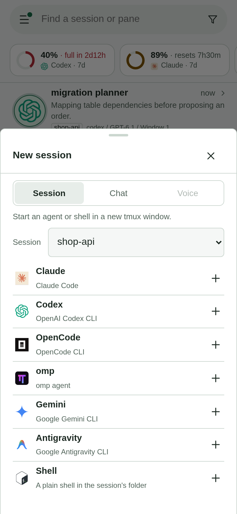
</p>

Switch a pane to the **Terminal** tab for the live screen, plus a key row for the
keystrokes a phone keyboard can't send (Esc, Tab, arrows, Page Up/Down, Enter, Ctrl
chords and the tmux prefix):

<p align="center">
  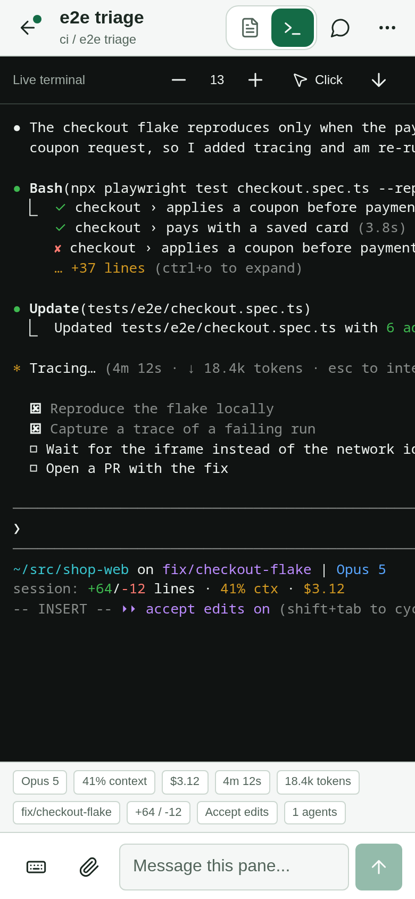
</p>

On a wide window the same page lays out as three columns — the session list, the
pane's Overview, and its live terminal — and `/` redirects to it. Start something new
without touching the machine: tap **+** (**New session**) beside Sessions and pick
**Session** (an agent or shell in a new tmux window, in an existing session or a new one
from a directory; `TMUXRC_LAUNCHERS` sets the agent choices), **Chat** or **Voice**
([Live Mode](docs/design/live-mode.md)). Agents' previews live under **Scratch**, and a
page can be pinned to the app's menu: [docs/scratch.md](docs/scratch.md).

**Why not `/remote-control`?** Every vendor's coordination story stops at its own
walls, and Claude Code's remote control is the clearest example: it is locked to the
Anthropic API (no Bedrock/Vertex) and only drives Claude Code. tmux-rc observes the
*terminal*, so it's vendor-agnostic on both axes — any agent, any model provider for
the summarization pass. See [`docs/PRD.md`](docs/PRD.md) and [`docs/design/overview.md`](docs/design/overview.md).

## Reboot without losing your fleet

A reboot, a crash or a `tmux kill-server` takes every session with it, and rebuilding forty
agents' windows by hand, then finding each one's conversation again, is an afternoon. So
tmux-rc records the workspace as it runs: the layout once a minute, and which conversation
each agent pane holds. When that tmux server is gone, the app offers it back.

<p align="center">
  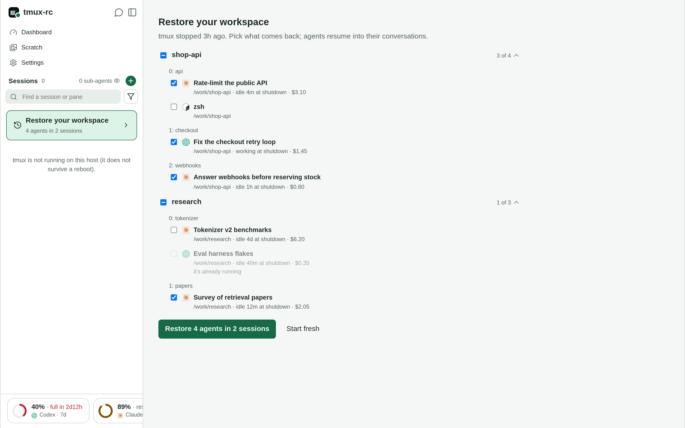
</p>

- **What comes back:** each session, its windows at their numbers, the splits and their
  sizes, hand-set names, zoom and focus, at the window size it had. Every pane starts in
  its directory, and each agent resumes into its own conversation on the account it ran on.
- **What's ticked:** agents active recently, or waiting on you. A long-idle agent and a
  plain shell are there to tick but start unticked; one already running elsewhere, or
  whose directory or conversation is gone, is greyed out with the reason.
- **Nothing comes back without your tap,** which names the count ("Restore 5 agents in 2
  sessions"). **Start fresh** drops the offer.

Why it works this way: [docs/design/reboot-restore.md](docs/design/reboot-restore.md).

## Review agents' work

Scratch is Artifacts for any agent: you review the planning docs, drafts, mocks and reports
your agents make where the work happens, on their own machine. It is a folder on your own machine that any agent
in any pane writes pages into, and the daemon serves it at `/scratch/` behind the same
front door as the app, so a page is on your phone with no second server or tunnel.

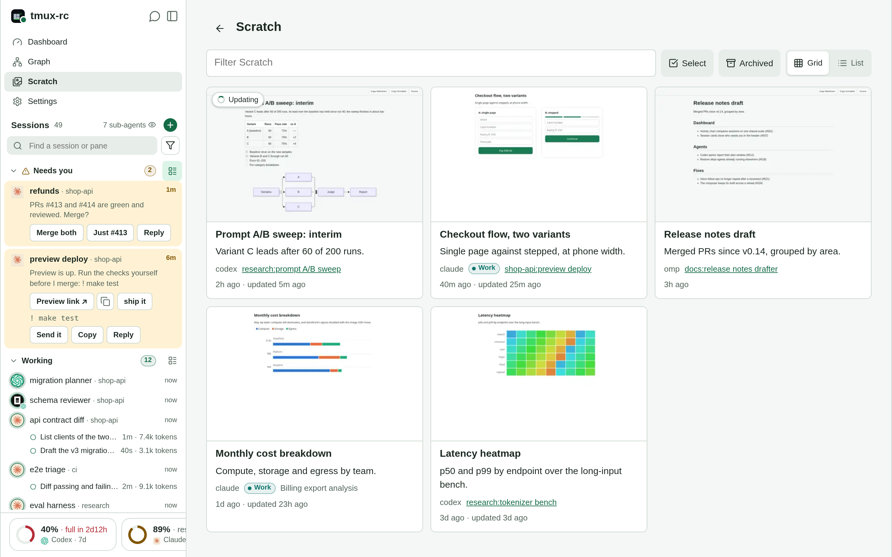

<p align="center">
  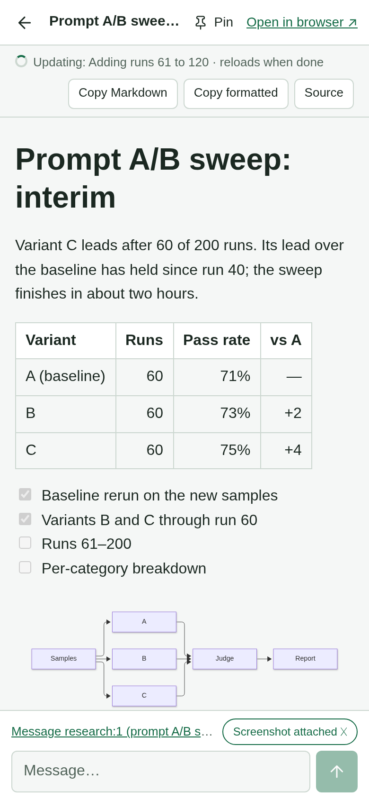
</p>

- **A gallery that knows the fleet.** Each card shows a thumbnail, a title and which session
  made the page, linked to that pane while it runs; a pane's overview lists its pages.
- **A link before the page.** An agent writes the folder's `meta.json` first, so the link
  shows **In progress** and turns into the page when it lands, with a push. A page being
  revised reads **Updating**, and a Markdown page reloads itself when done.
- **Reply to the maker.** The viewer's message box goes to the agent that wrote the page,
  with a screenshot of the page at your screen's width.

### Where the work happens

You review a page on the agents' own machine, beside the repo, the build and the pane that
made it. There is nothing to upload and no hosted service in between, so private work can
go there (only a page without a description has its text sent to the parse model, for one
sentence). And nothing locks you to a vendor: any model, any harness, any script that writes
a file can publish one. The full comparison with claude.ai Artifacts, and setup:
[Scratch](docs/scratch.md#scratch-and-claudes-artifacts).

> **Status.** In daily use on real fleets: every pane on the server is watched,
> classified and answerable from the phone, with push notifications, chat and voice over
> the fleet, restore after a reboot, scratch previews, agent accounts and a history
> dashboard. It is a single-user tool with no authentication of its own (see
> [Run](#run)); the [PRD](docs/PRD.md)'s non-goals stay out of scope.

[Why tmux-rc](docs/comparisons/_index.md): the existing tmux workflow we wanted to
keep, the requirements other tools left open for us, and the alternatives we researched.

## Run

Prereqs: `tmux`, Python 3.12+, [`uv`](https://docs.astral.sh/uv/), and Google Cloud
credentials for Vertex (the Gemini Flash Lite classification pass). Because the daemon
runs unattended for long stretches, it authenticates with a long-lived **service-account
key** rather than developer ADC (which expires and needs a browser reauth — see
[docs/design/durable-vertex-auth.md](docs/design/durable-vertex-auth.md)). Point
`GOOGLE_APPLICATION_CREDENTIALS` at the key file — an **absolute** path, since google-auth
does not expand `~` (`.env.example` has the mint command).

```bash
uv sync
cp .env.example .env          # then edit .env: GOOGLE_CLOUD_PROJECT + GOOGLE_APPLICATION_CREDENTIALS

# In another terminal, start a tmux session and run an agent in it:
tmux new -s work
#   ... run codex / claude / gemini / opencode / anything ...

# Start tmux-rc (config is loaded from .env automatically):
uv run python -m openbus.server
```

> **The daemon has no authentication, so run it only on a single-user machine.** There is
> no login, no API key, no token — any client that can reach the port can call the API, and
> `POST /api/panes/{id}/send` types into a real terminal. It binds `127.0.0.1:18030`, but
> a loopback bind is not a permission check: anyone who can reach that port can control
> your terminal, which on a shared host means every other account on it.

To browse it from a phone on the same network, set `TMUXRC_HOST=0.0.0.0` and open
`http://<machine-lan-ip>:18030` — that hands the same control to everyone on the LAN, so
only do it on a network you trust. For access from anywhere else, put something
authenticating in front of it: see [docs/deploy/](docs/deploy/) — Tailscale keeps it off
the public internet entirely, and there's a step-by-step Cloudflare Tunnel + Access
runbook if you need a public hostname.

### Run it as a service

Long term you don't want the daemon living in a terminal that might close — it should
survive reboots and restart itself if it dies. `systemd --user` units for the daemon and
the tunnel client ship in [`deploy/systemd/`](deploy/systemd/):

```bash
make install-units                        # copy units, enable + start them, enable-linger
journalctl --user -fu tmux-rc             # daemon logs (replaces watching a pane)
systemctl --user restart tmux-rc          # after a git pull or a .env change
systemctl --user restart tmux-rc.target   # both halves (daemon + tunnel)
```

`make install-units` stamps the unit's `WorkingDirectory` with the checkout you run it
from, so it works wherever you cloned, and builds the `agent-history` helper when Go is
installed. On a host with an encrypted `$HOME`, install with `make install-units
LINGER=0`: lingering units would crash-loop before you log in.

**Exposing it off-LAN** is optional and yours to choose — this repo doesn't ship a tunnel.
`tmux-rc-tunnel.service` is a slot for whichever reverse-tunnel client you use
(cloudflared, tailscale funnel, frp, something in-house): point its `ExecStart` at the
binary, put the client's config in `~/.config/tmux-rc/tunnel.env` (see
[`deploy/tunnel.env.example`](deploy/tunnel.env.example)), then
`systemctl --user start tmux-rc-tunnel`. The unit stays inactive until that file exists,
so you can ignore it entirely on a LAN-only setup. Whatever you pick should
**authenticate** — the daemon itself has no auth.

### Phone: notifications, Chat and Voice

Install the app from your daemon's address ([Install the client](docs/client-setup.md)),
then turn on **Push notifications** in its Settings: a pane that **Needs you** notifies
every subscribed device, and a tap opens that pane. iOS grants Web Push only to an
installed Home Screen app, so follow [iPhone setup](docs/iphone-setup.md) there; it also
covers Voice (Live Mode), lock-screen behaviour and what triggers a notification.

The checkout *is* the deploy — the unit runs this directory and loads its `.env`, so
upgrading is `git pull` + `restart`. For iterating on the daemon itself, stop the unit
and run `make dev` in a pane as usual; the two modes share the same command and config.
See [docs/design/deployment.md](docs/design/deployment.md) for why user units + linger
(and not containers, system units, or a supervising parent).

### Run without cloning

`uv` installs straight from the git repo — no manual clone or checkout to
manage. The wheel bundles the phone UI, so this is fully self-contained (`tmux-rc` is a
console script; reload defaults off when installed). You still need `tmux`, a running
agent, a Vertex service-account key file **on the machine**, and the env vars pointing at
it — `uvx` fetches the code, not your credentials.

```bash
uvx --from "git+https://github.com/querystory/tmux-rc.git" tmux-rc
# or pin a branch/tag/commit:
uvx --from "git+https://github.com/querystory/tmux-rc.git@main" tmux-rc
```

The `docs/` site is checkout-only (not bundled); the phone dashboard and API work
without it.

**Setting the env vars.** There's no repo-root `.env` here, so use one of (real shell env
vars always win — `.env` never overrides them):

```bash
# 1. Exported shell env vars (simplest, persists across runs in the shell):
export GOOGLE_CLOUD_PROJECT=your-gcp-project
export GOOGLE_APPLICATION_CREDENTIALS=/abs/path/to/sa-key.json   # absolute — no ~
uvx --from "git+https://github.com/querystory/tmux-rc.git" tmux-rc

# 2. Inline, for a one-off run:
GOOGLE_CLOUD_PROJECT=your-gcp-project \
GOOGLE_APPLICATION_CREDENTIALS=/abs/path/to/sa-key.json \
  uvx --from "git+https://github.com/querystory/tmux-rc.git" tmux-rc

# 3. A .env in (or above) the directory you launch from — the daemon searches upward
#    from the cwd when there's no repo-root .env:
mkdir -p ~/tmux-rc && cd ~/tmux-rc
# create .env with GOOGLE_CLOUD_PROJECT + GOOGLE_APPLICATION_CREDENTIALS (see the table
# below and `.env.example` in the repo)
uvx --from "git+https://github.com/querystory/tmux-rc.git" tmux-rc
```

> `GOOGLE_APPLICATION_CREDENTIALS` **must be an absolute path** — google-auth does not
> expand `~`. To run heuristics-only with no Vertex creds at all, set `TMUXRC_NO_LLM=1`
> (see the table below). All other `TMUXRC_*` vars work the same way.

### Config (env)

Loaded from `.env` at startup (real shell env vars still override). See `.env.example`.

| var | default | meaning |
| --- | --- | --- |
| `GOOGLE_CLOUD_PROJECT` | — | GCP project for Vertex (required for the LLM pass) |
| `GOOGLE_APPLICATION_CREDENTIALS` | — | absolute path to the Vertex service-account key ([why](docs/design/durable-vertex-auth.md)) |
| `VERTEX_AI_REGION_GEMINI` | `global` | Vertex region |
| `TMUXRC_GEMINI_MODEL` | `gemini-3.1-flash-lite` | the classifier model |
| `TMUXRC_IN_PER_M` / `TMUXRC_OUT_PER_M` | `0.25` / `1.50` | its USD prices per 1M tokens, for the cost figures |
| `TMUXRC_LLM_TIMEOUT_MS` | `20000` | per-call timeout |
| `TMUXRC_NO_LLM` | unset | `1` runs heuristics-only (no Vertex calls) |
| `TMUXRC_TARGET` | unset (all panes) | watch one pane: a pane id (`%3`) or `session:window[.pane]` by index. The derived labels `.env.example` describes also work; a card's title does not |
| `TMUXRC_TMUX_SOCKET` | unset (default server) | a `tmux -L` socket name, for a dev daemon that must not touch your real server |
| `TMUXRC_HOST` / `TMUXRC_PORT` | `127.0.0.1` / `18030` | HTTP bind |
| `TMUXRC_HOST_NAME` | the hostname, up to its first dot | this machine's name at the end of each app tab's title, to tell machines apart |
| `TMUXRC_ALLOWED_HOSTS` | loopback names and the bind address | extra `Host` names the daemon answers to, comma-separated: the tunnel's upstream host, a LAN name |
| `TMUXRC_ALLOWED_ORIGINS` | the local origins on `TMUXRC_PORT` | extra browser origins allowed to write and open Live sockets: your tunnel's `https://host`. Not auth |
| `TMUXRC_TUNNEL_SECRET_FILE` | unset | opt-in: the tunnel client must echo this file's secret before its `X-Tunnel-User` is trusted ([SECURITY.md](SECURITY.md)) |
| `TMUXRC_AUDIT_KEYS` | `1` | `0` logs actions without the keys typed (no-echo passwords would otherwise reach the journal) |
| `TMUXRC_API_DOCS` | unset | `1` serves `/apidocs` and `/apiredoc` (they load third-party JS); `/openapi.json` is always on |
| `TMUXRC_DOCS_DIR` | `docs-site/serve` beside the package | the built docs site served at `/docs/` (`make docs`); absent = no Docs button |
| `TMUXRC_ENTER_SETTLE_S` | `0.3` | pause between typed text and the Return that submits it; agent TUIs read a Return inside a paste burst as a newline. Raise it if a TUI swallows submits, `0` disables |
| `TMUXRC_LAUNCHERS` | Claude, Codex, OpenCode, omp, Gemini, Antigravity, Shell | New session entries, inline JSON or a path to it: `[{"label":"Codex (high)","command":"codex -c model_reasoning_effort=high","icon":"codex"}]`. `icon`: a built-in logo (claude/codex/gemini/antigravity/opencode/omp/shell) or an image URL; `provider` (`claude`/`codex`) picks whose [accounts](docs/design/agent-accounts.md) it runs on when the icon does not say |
| `TMUXRC_LIVE_MODE` | unset (off) | `1` enables Chat and Voice ([Live Mode](docs/design/live-mode.md)) |
| `TMUXRC_LIVE_REGION` | `us-central1` | Vertex region for voice models (needs one that serves them; not `global`) |
| `TMUXRC_LIVE_MODELS` | Gemini 2.5 voice on Vertex, plus the chat defaults | the models Chat and Voice offer, inline JSON or a path (`.env.example` has the shape, backends and rates) |
| `GEMINI_API_KEY`, `OPENAI_API_KEY`, `ANTHROPIC_API_KEY`, `AZURE_OPENAI_API_KEY` + `AZURE_OPENAI_ENDPOINT` | — | keys for the other Live backends, read from `~/.config/tmux-rc/openai.env`, never `.env`; a model whose key is missing is listed greyed with the reason |
| `TMUXRC_GPT_LIVE_VOICE` / `TMUXRC_GPT_LIVE_BACKEND` | `marin` / `gpt-5.6-luna` | GPT-Live's voice and backend model (offered when `OPENAI_API_KEY` is set); `TMUXRC_GPT_LIVE_{INPUT,CACHED,OUTPUT}_PER_M` price a backend override |
| `TMUXRC_PUSH_SUBJECT` | `mailto:tmux-rc@openbus.io` | VAPID contact; a real `mailto:`, or Apple rejects delivery |
| `TMUXRC_PUSH_ALLOWED_HOSTS` | Apple, Google, Mozilla, Microsoft relays | push endpoints accepted at subscribe, hosts or `.suffix`es |
| `TMUXRC_SCRATCH_DIR` | unset (not served) | directory served read-only at `/scratch/` for agents' previews — [docs/scratch.md](docs/scratch.md) |
| `TMUXRC_SCRATCH_ADVERTISE` | unset (off) | `1` exports the scratch dir and URLs to tmux's global environment, so agents in new panes find it |
| `TMUXRC_SCRATCH_URL` | unset | the URL you open tmux-rc at, plus `/scratch`, advertised with the dir |
| `TMUXRC_THUMB_BROWSER` | Playwright's bundled headless Chromium | the browser that renders scratch thumbnails; never your own profile |
| `TMUXRC_HISTORY_DB` | `~/.local/state/tmux-rc/history.sqlite3` | the history database (pane history, usage, layouts for restore) |
| `TMUXRC_WORKSTREAMS` | unset | `{"name": ["keyword", …]}`: your own grouping of open loops on the dashboard, when nothing better links them |
| `TMUXRC_AGENT_HISTORY` / `AGENT_HISTORY_DIR` | on `PATH` or `~/.local/bin` / `~/agent-history` | the `agent-history` binary Chat uses to find past conversations, and its index |
| `TMUXRC_PREFER_IPV4` | `1` | outbound connections prefer IPv4; `0` if your v6 works and v4 does not |
| `TMUXRC_RELOAD` | `1` from a checkout, `0` installed | restart on source changes (`make dev`); the unit sets `0` |
| `TMUXRC_LOG_LEVEL` | `INFO` | daemon log level |
| `TMUXRC_METRICS_LOG` / `TMUXRC_LLM_LOG` | `/tmp/tmux-rc-metrics.jsonl` / `/tmp/tmux-rc-llm.log` | per-call cost ledger (JSONL) and the model's inputs and outputs, for debugging |
| `OTEL_EXPORTER_OTLP_ENDPOINT` / `OTEL_EXPORTER_OTLP_HEADERS` | unset | OTLP/gRPC receiver for per-call telemetry, and its `authorization=Bearer <token>`; unset = off |
| `TMUXRC_QSDEBUG` | unset | `1` also sends raw pane text and model output to telemetry (privacy: content leaves the host) |

### What it costs

Measured, not estimated — from a month of per-call telemetry on a real fleet (45 panes
across 3 hosts, agents running most of the day), at Gemini 3.1 Flash Lite list prices
($0.25/M input, $1.50/M output):

- **~$5/day for the whole fleet** (~$33/week). A classify call is ~10.5k tokens in /
  ~200 out (≈$0.003); calls fire only when a pane's content actually changes, so cost
  scales with how busy your agents are, not with pane count — idle panes are free.
- Voice (Live Mode) is billed per session and has been immaterial next to the
  classifier (a few dollars per month of daily use).
- A lightly used single-pane setup runs pennies per day. `GET /api/state` reports
  running totals, and the OTLP telemetry (above) records per-call tokens/cost if you
  want the real queryable ledger.

## API

The daemon serves the phone's PWA and an HTTP API on `:18030` — usable by anything
(curl, scripts, agents), not just the phone. The ones to start with:

| Endpoint | What it gives you |
|---|---|
| `GET /api/digest` | **"What's going on":** per pane — headline, activity, pending question, summary, recent events |
| `GET /api/state` | The phone's live view: current cards, usage totals, `llm_error` |
| `POST /api/panes/{id}/send` | Type text or keys, or answer a prompt, in a real tmux pane |
| `POST /api/panes/{id}/compose` | Send a draft of text and files to a pane |

The full list, and `/openapi.json` for the exact version you run:
[docs/api-reference.md](docs/api-reference.md).

## How it works

- **`tmux.py`** — non-disruptive `capture-pane` reads + `send-keys` writes.
- **`watcher.py`** — polls every 1.5s, tracks idle time, keeps a snapshot ring buffer.
- **`classify.py`** — heuristics first (tool, activity, context %, y/n & menu prompts);
  a Gemini Flash Lite pass reads the screen only when the pane changed, and decides the
  card: headline, question and answers, offers, copyables, links.
- **`server.py`** — FastAPI: the API, the PWA, `/scratch/`, `/docs/`.
- **`push.py`**, **`live.py`**, **`restore.py`**, **`history.py`**, **`scratch.py`**,
  **`accounts.py`** — notifications, Chat and Voice, reboot restore, the history
  database, previews, agent accounts.
- **`web/`** — installable vanilla-JS PWA.

The end-to-end tour, with diagrams: [docs/design/architecture.md](docs/design/architecture.md).

## License

[MIT](LICENSE) © QueryStory, Inc.
