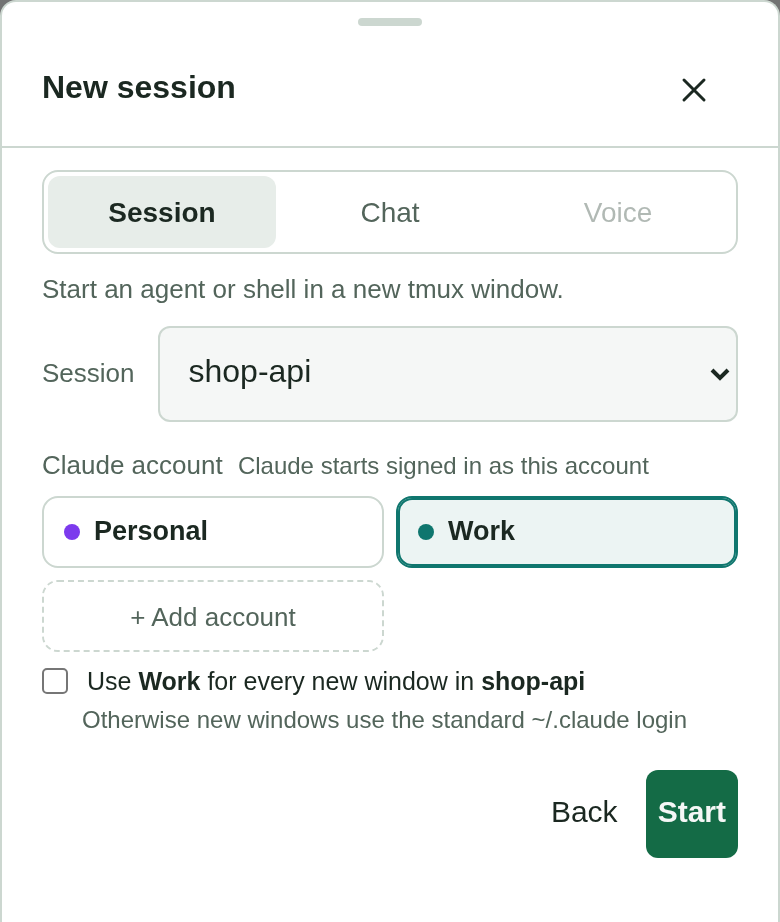
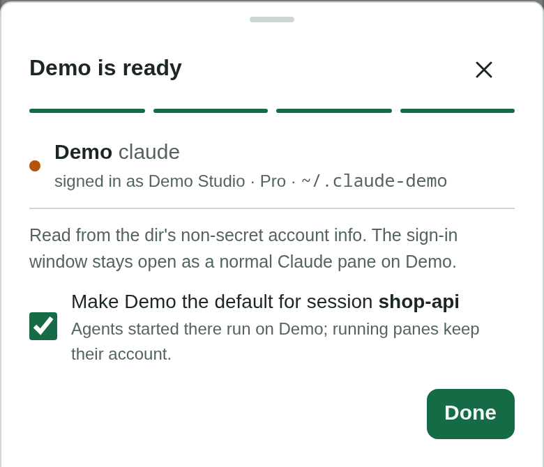

# Agent accounts: several Claude or Codex logins on one machine

Status: implemented (`openbus/accounts.py`, `web/m/accounts.js`). Approved from the
playable prototype in the scratch previews (`accounts/`).

## Why

The motivating case is one person with a personal Claude plan for open-source work and a
company plan for company work, running both at once, never logging out and back in.
Claude Code and Codex already support this: each config dir (`CLAUDE_CONFIG_DIR`, default
`~/.claude`; `CODEX_HOME`, default `~/.codex`) is its own login, settings and transcripts.
A pane's account is fixed by the environment its agent started with, so nothing ever
"switches". tmux-rc already read that variable from each agent process, and meters,
transcripts and Expunge followed it. What was missing was naming the accounts, choosing
one for a new pane, and adding a second one without leaving the phone.

## The model: a profile is a provider plus a config dir

Profiles are discovered, not configured: `~/.claude`, every `~/.claude-<name>`,
`~/.codex*`, any dir a live pane uses, and any dir added through the UI. A dir is listed
once someone is signed in there, or once it was added here (then it shows as "not signed
in" until the sign-in finishes).
A pane running on another HOME's default dir is not one of them: that is someone else's
setup, whose name tmux-rc could not read (its `.claude.json` sits beside the dir, under that
HOME) and which no launch could pin with the config variable alone, so it is left out
rather than listed half-working.

A profile is named by the user's label, else by the non-secret `oauthAccount` fields in
the dir's `.claude.json`: the organisation name, with a personal plan's
"<email>'s Organization" shortened to the email, then the display name, then the email. Two
unlabelled accounts that would read the same (two people of one organisation) add the
display name or the email's local part ("QSI · sam"), and the full email only if that
clashes too.

Names alone hide one failure: a `/login` run in a pane without `CLAUDE_CONFIG_DIR` signs
the default dir in to whatever login was chosen, and a labelled dir keeps its label while
holding the same login as another. Nothing then shows that two "accounts" are one, or that
a login has vanished. So each profile also carries its login's email, shown as secondary
text wherever an account is listed, and two dirs on one login (the same account and
organisation ids) flag each other: the Accounts sheet warns on both rows, and the Move sheet keeps
such a target listed but says the copy would stay on the same login and its limits. Hiding it instead would leave
the user wondering where the account went. Neither the email nor the shown name is the key:
one email in two organisations is two plans, and names are display values, so without an
organisation id no match is claimed.
The credentials file is never opened by this code: Codex keeps no non-secret identity
file, so only the presence of its login file is checked. The old meter labels (the email's
local part, or the full email on a clash) are gone: for one person with two plans they put
the same full email on every meter.

The store (`$XDG_STATE_HOME/tmux-rc/accounts.json`) holds only what discovery cannot
know: labels, a colour index per dir, and forgotten dirs. Colours are handed out on first
sight (the lowest unused) and kept, so adding a third account never recolours the first
two.

## The single-account rule

Account UI appears only once a provider has two or more signed-in accounts, and the test
is per provider. With one Claude and one Codex account nothing changes from before: no
badges, no picker, no filter, no grouping in Plan usage, no account on the consent card.
With two Claude accounts and one Codex, Claude panes get badges and Codex panes do not,
because the Codex icon already says which account it is. Most people have one account
each, and for them account chrome would only be noise and something to misread.

The one addition everyone sees is **Accounts…** in the ☰ menu, because adding a second
account has to start somewhere. On a wide screen that menu now sits in the sidebar head;
the wide layout had no menu before.

## Showing it

- **Badges** ("● Work") on the phone's rows, the sidebar's rows and the pane header, in
  the account's colour. The pane header puts it first on a phone, which ellipsizes the
  end. Every place that names an account draws this one chip, so the same account never
  looks two ways on one screen; a long name truncates inside it.
- **Session cards** on the dashboard carry the chip of the session's own default (the
  dir its tmux environment sets), and nothing when it sets none or sets what the global
  environment already does: a session that starts new windows on an account other
  sessions do not is worth seeing at a glance; a default every session shares is not.
- **Usage strip:** with several accounts the meters become one row that swipes sideways
  and snaps per meter, most urgent first (full soonest, then the highest pace at the
  reset). Two meters fit on a phone with a third of the next peeking in under a fade, so
  the row reads as one that scrolls; a two-meter split looked complete and hid the swipe.
  Seven meters in a two-column grid would push the list off a phone's screen, and what
  needs attention must never sit behind a swipe. Each meter names its account with the
  same chip as the rows, in its bottom corner across from the reset, and its title keeps
  just the window: a name in the title was truncated first, read as part of the window
  ("7d QSI"), and left a one-account provider's meter looking unnamed beside it.
- **Dashboard Plan usage:** wide, every meter on one line, grouped per account with one thin
  divider between groups. Each group is headed by its chip, flush left over its first meter,
  with the details (who, plan, dir, panes) in its tooltip, and Codex gets a chip like the
  rest. The meters share the line evenly, down to 130px each, which fits ten on a 1500px
  card; below that the line scrolls with the strip's edge fades rather than wrapping. A
  wrapped second row looked broken: its chips floated in the gap, and its groups did not
  line up with the first row's. Chips centred over their groups, on the heading line to
  save a row, read as loose labels rather than headings, so they now take a row. The chip
  names the account once over its meters, so the meters carry none. A phone's dashboard
  uses the strip, a chip on each meter.
- **Filter** is a list filter, so it sits with the list's other one rather than in ☰ among
  settings: on wide, a "Panes from" group (All accounts, then each account) under "Show" in
  the list's All ∨ dropdown, combining with it (Running + Work is Work's running panes),
  its dot on the dropdown's label; a phone has no dropdown (its tab bar is the state
  filter), so a row of chips under search. While on, a "Filtered: Work ✕" pill shows under
  search on wide, and under a phone's header on the views without the chips (the
  dashboard). On wide the pill also names a search (`"api" ✕`, in the URL as `q=api`), so
  one line says everything narrowing the list; a phone's list shows its search box and
  nothing else is searched, so a phone's pill leaves it out. It applies to the list, the strip and the dashboard, Open loops included:
  a loop shows only if a pane on the account holds it, so a PR or worktree with no pane,
  which no account owns, is hidden while filtered.
  It lives in the URL beside the state filter (`#filter=running&acct=claude-work`, the
  account's dir less its usual `~/.`: unique, unchanged by a rename, and readable), not in localStorage: reload, a shared link and
  Back/Forward restore it, one source of truth for both filters. Picking replaces the
  history entry, as the state filter does, so Back leaves the screen instead of replaying
  taps. A bare URL (the installed app's launch) starts unfiltered, as the state filter
  always has: a filter remembered silently across launches would hide panes that need you.
- **Consent card:** a chat action on a pane names the account the pane runs on, and says
  that sending never changes it.

## Choosing the account for a new pane

The mechanism is a default account per tmux session:
`tmux set-environment -t <session> CLAUDE_CONFIG_DIR <dir>`. tmux hands it to every window
created there afterwards, a typed `prefix c` and a resume included. It is what a user
would do by hand, and it stays visible in tmux. New window preselects the session's
default and always shows a "Default for this session" control. When nothing sets the
variable (unset, or removed with `-VAR`), it says so ("no account default; new windows use
Work, the standard dir") rather than implying a choice nobody made.

Launching on an account wraps the launcher in `env CLAUDE_CONFIG_DIR=<dir>` (or
`env -u CLAUDE_CONFIG_DIR` for the default dir), so the pick holds whatever the session's
default is. Unset rather than set for `~/.claude`: Claude Code reads `~/.claude.json`
beside the default dir, but `<dir>/.claude.json` inside an explicit one, so setting the
variable to `~/.claude` would look signed out. A resumed Claude session is pinned the same
way to the dir its transcript is in, since it resumes only under the account that owns
it; agent-history now indexes every `~/.claude*` dir so those sessions are offered at all.

## Adding an account

From ☰ → Accounts… → Add account, or "+ Add account" in New window's picker:

1. **Name, provider and dir.** The dir is suggested as `~/.<provider>-<name>` and stays
   visible and editable, because the dir is the account. One already listed stops the
   step. An existing dir is reused as it is; a new one is created with mode 700.
2. **Share your setup (optional).** Symlink individual files from the provider's default
   dir (`CLAUDE.md`, `skills/`, `hooks/`, `statusline.sh`) so there is one copy to edit.
   `settings.json` is off by default because it often carries work-only hooks, MCP servers
   or permissions. The login, `.claude.json` and `projects/` are listed as never linked.
3. **Sign in.** tmux-rc opens a normal new window running `CLAUDE_CONFIG_DIR=<dir> claude`
   (or `CODEX_HOME=<dir> codex login --device-auth`), and the user signs in there: `/login`
   in Claude, while the Codex command is the sign-in itself. Both flows finish in a browser on another machine, since tmux-rc users are
   remote: Codex's device-code flow shows a link and a one-time code (plain `codex login`
   waits on a localhost callback a remote browser cannot reach), and Claude's `/login` shows
   a link whose page hands back a code to paste into the window.
   The command after the variable is editable (to add a flag the provider grows), but the
   server pins the variable to the account's dir, runs the command as argv with no shell,
   and accepts it only if it starts with the provider's own binary. Codex is signed in
   when `auth.json` exists or, failing that, when `codex login status` says so: its login
   can live in the OS keyring instead, where no file shows it. tmux-rc never shows a
   password field, never handles a token and never drives the login; it only polls the dir's non-secret account info until it appears. That keeps the
   credential boundary exactly where the provider put it.
4. **Done:** the identity read from that info, and a pre-ticked "make it the default for
   session X".

The whole sequence, each step cropped to its sheet, is the `accounts-add-*` set in
`scripts/screenshots.mjs`, shot against the demo fleet with a stub sign-in screen.

Edge cases: an abandoned sign-in (Cancel, or its window closed) adds nothing beyond the
listed "not signed in" dir, with Finish sign-in and Remove. Rename changes only the label.
Remove takes the account off tmux-rc's list; the dir, its login and its transcripts stay
on disk and running panes keep running. The default `~/.claude` and `~/.codex` cannot be
removed.

## Moving a session to another account

A plan runs out mid-task, or work started on the wrong account. Pane "…" → **Move to
another account…** (shown only when the pane's provider has two or more signed-in
accounts) lists the provider's other accounts. Picking one copies the session into that
account's dir and opens a new window in the same tmux session and cwd running
`CLAUDE_CONFIG_DIR=<dir> claude --resume <id>` (`codex resume <id>` under `CODEX_HOME`).

It is a copy, never a move. The source pane keeps running and is never killed, and the
original transcript stays readable on the old account; the user exits the old pane when
they choose. Moving files out from under a running agent would break it, and a copy
that turns out wrong costs nothing to delete, while a lost transcript cannot come back.
From then on the two diverge under one session id, each in its own dir, which is the
same thing as resuming one session twice and confuses nothing that looks a session up
by its dir.

What is copied is decided by testing what `--resume` needs, not by copying the whole
session's footprint. The transcript alone is enough: a second, logged-in account given
only the `.jsonl` answered from the conversation's context, with nothing tying the session
to the account that started it. The `<id>/` folder (subagent transcripts, externalised
tool results) and `file-history/<id>/` (the /rewind snapshots) come along so the resumed
session is whole. Session env, tasks, todos and the process registry are rebuilt on start
and are left behind. Codex needs only its rollout files, a resumed thread's later
segments included; its sqlite index finds an unindexed rollout by scanning. The list is a
subset of Expunge's per-session table, so one table says where a session's files are. The
source keeps running while it is copied, so a record it was still appending is cut from
the end of each copied log: the agent only appends, so the rest is whole, and a resume
reads whole lines. Stopping the source first was rejected, since the move exists for an
agent the user is still in the middle of.

An older copy of the session already on the target (an earlier move, or one made by
hand) is never overwritten silently. The API refuses with 409 and the copy's age, and the
sheet asks: **Replace it** deletes that session id's transcript, `<id>/` folder and
file-history there, and nothing else, then copies afresh; **Resume that copy** opens it
as it is. Either is an explicit flag on the request, so a client that does not know about
the choice still gets the refusal. Replacing gives up the older copy before the new one
lands, which is acceptable because the original it came from is still on the source
account. Resume needs that copy's transcript, not just any of its files. No move at all,
and so neither choice, is offered for a copy that an agent is running on the target right
now: Claude's registration of it there (one that can't be read counts, since it could be
this session), a process holding one of its files open (Codex's
app-server keeps the rollout open), or, in the moment before either exists, the session
id on a command line, as a move's resume has: replacing
files under a live agent strands its later writes, and resuming it twice puts two agents
on one transcript. Moves run one at a time, through the new window's launch until its agent shows as
running, so two
requests cannot pass these checks together, and the sheet takes one tap at a time. A copy
that fails partway is removed. Nothing is written or deleted through a folder
in the target that links out of it, a session whose own files include a link is refused, and the agent's command is checked to exist before
anything is copied, so a resume that cannot start leaves no stray copy. The pane's own
account is refused too, compared by identity so no spelling, link or bind mount slips by, and the sheet reloads the accounts
before listing them, since a window the move itself just opened may not have been
attributed to its account yet.

Once the new window runs, the sheet offers **Exit the old pane**: it types the agent's own
`/exit` into the source pane, bound to its incarnation and the session id, and is refused
if either changed. It is a button, not automatic, and never a kill, so an agent mid-turn
is not cut off without the user deciding to.

A session with no transcript yet (registered, nothing written)
is refused rather than opened as an empty resume, and so are two dirs where one sits
inside the other, which would make the copy chase its own output. A dir that has never opened the folder shows the
provider's own "trust this folder" prompt in the new window first. Answering it is left to
the user rather than copied over from the old account, because it is a security decision
the provider asks per account. Like Expunge, the request is bound to the pane incarnation
the menu was drawn for, and it is audited with the session id and the target dir.

## Safety

- No credentials file is ever shared, copied or linked, and discovering, naming or adding
  an account never reads one. The Plan usage meter is the exception it always was: it
  reads each metered account's OAuth token in-process to fetch its limits
  ([plan usage](plan-usage.md)), now for every listed account rather than only those a
  pane uses.
- Nothing switches accounts automatically, and nothing routes work to "the plan with
  headroom". A full plan is shown, never worked around.
- Login and logout stay in the provider's own UI.

## Alternatives considered

- Guessing the account from the repo or cwd: rejected, a wrong guess silently bills the wrong plan.
- Linking whole dirs between accounts: rejected, it silently shares the login.
- A login form or token paste in tmux-rc: rejected, it moves the credential boundary into tmux-rc.
- Per-account rows in the strip: rejected, several accounts push the list off a phone.
- Moving (not copying) a session between accounts: rejected, see "Moving a session" above.
