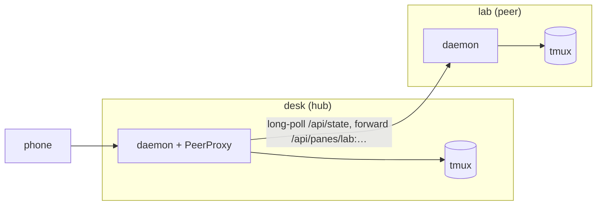

# Several machines, one fleet

Status: implemented (`openbus/peers.py`, `TMUXRC_PEERS`, the New session sheet's Machine).

## Why

One machine runs out before the agents do: every agent pane costs memory, so someone
who outgrows a box adds a second machine and runs a second tmux-rc on it. That gives them two phone apps, two lists, and two places to look
for what is waiting, which is the split tmux-rc exists to remove. They want one list.

## The shape: a hub and its peers

Every machine runs the daemon it already runs, unchanged. One of them, the **hub**, is
told about the others, its **peers**:

```sh
# the hub's .env
TMUXRC_PEERS=lab=http://localhost:18031,gpu=http://gpu.tailnet.example:18030
```

The hub shows its own panes and every peer's in one list, and forwards anything done to
a peer's pane to that peer. The phone talks only to the hub, at the address it already
uses, through whatever tunnel it already has.



### Why not one daemon driving remote tmux over ssh

It looks smaller, since a daemon only runs `tmux capture-pane` and `send-keys`, but most
of what makes a card useful reads the machine itself: the agent's process and its
children, its transcript on disk, its account directories, its worktrees, its scratch
pages. Over ssh each of those would need its own remote path. A peer daemon already
reads all of them locally, so the hub only has to ask it.

### Why not the relay

The relay could hold a tunnel per machine and let the app switch between them. That only
gives you switching, not a merged list, and it changes the relay and tunnel client, which
not every deployment runs. The hub needs only a network path to each peer.

## Naming: `machine:id`

A peer's pane `%3` reaches the phone as `lab:%3`, and its session `main` as `lab:main`.
tmux allows a colon in neither, so a prefixed name never collides with one of the hub's.
Every surface that groups or labels by session (the list, the sidebar, Atlas, the fleet
graph) shows the machine without knowing that machines exist. Each pane also carries a
`machine` field, and `/api/state` lists `machines` (the hub first, then each peer with
`online` and its last error).

## Routing (`PeerProxy`)

An ASGI middleware, innermost, so a forwarded request has already passed the hub's Host
and Origin checks. A request goes to a peer when it names one:

1. **In its path:** `/api/panes/lab:%3/live` goes to lab as `/api/panes/%3/live`. This
   covers live frames, history, send, compose, images and every other per-pane call.
2. **In `?machine=lab`:** calls that name no pane, like `/api/launchers` and
   `/api/sessions/dirs`, and `POST /api/sessions` for a new session there.
3. **In its JSON body:** a `pane_id`, `pane` or `session` with a peer's prefix, such as
   a new window in `lab:main`. The prefix is stripped before forwarding. A body that
   names two machines is refused.

A JSON reply's top-level `pane_id`, `pane` and `session` come back prefixed, so the
window the hub just opened on lab is `lab:%9` to the phone. Origin, Referer and
`Sec-Fetch-*` are dropped, because the hub has already checked them and they name the
hub, not the peer. The identity headers pass through, so the peer's audit log still
says who acted.

## State: one version for all of them

The hub holds a long-poll on each peer's `/api/state`, exactly as a phone would, and
bumps `Fleet.seq` whenever a peer's state changes, it goes away, or it comes back. The
hub's `version` is its watcher's version plus `seq`. Both only grow, so the sum does
too, and the phone's long-poll ends on a change on any machine. A peer that stops
answering drops out of the list, the app says once that it can't be reached, and it is
polled again every 5s.

## Reaching a peer

The daemon has no authentication of its own: it trusts the network (docs/PRD.md).
Never bind a peer to a public address. Use either:

- **An ssh forward** from the hub: `ssh -N -L 18031:localhost:18030 lab`, then
  `lab=http://localhost:18031`. The peer keeps listening on loopback only. Run it as a
  `--user` unit with `autossh` (or `Restart=always`) so it comes back.
- **A private network** (Tailscale, WireGuard): bind the peer to its private address with
  `TMUXRC_HOST`. Its Host check then accepts that address.

## Not yet

- **Push notifications** come from each daemon's own watcher, and the phone subscribes
  only at the hub, so a peer's pane that needs you shows up in the list but sends no
  push. Next step: the hub raises pushes from the peer states it already follows.
- **Accounts** are per machine. The New session sheet's account picker lists the hub's
  accounts, so it is skipped for a peer, and agents there start on that machine's
  default account.
- **Scratch pages, pins, Recent and history** (the heatmap and usage) stay per machine.
  A peer's scratch links point at the peer, and the hub does not serve them.
- **Live Mode** (voice) routes only to the hub's panes.
