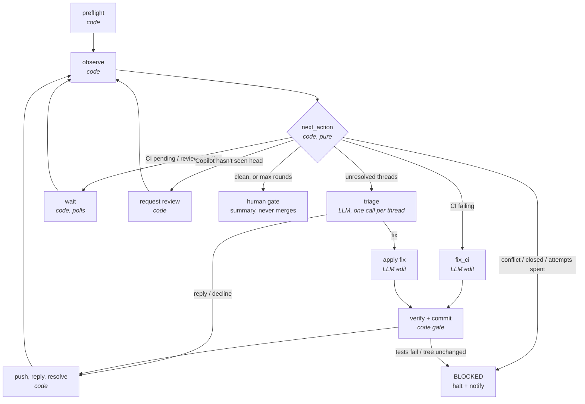

# Design: the PR loop as a graph

Status: **v1 implemented** (`scripts/pr_loop.py`, tests in `tests/test_pr_loop.py`).
Integration rebuild, rebasing and fork PRs are deferred (below).

## Why

Getting a pull request from "pushed" to "ready to merge" is the same chore every time:
wait for CI, read the failing log, fix it, push; ask Copilot to review, read each thread,
fix or answer it, resolve it, ask again; repeat until it comes back clean. Most of that is
plumbing. Only two steps take judgement: *what is this CI failure and what is the smallest
fix*, and *is this review comment right, and what do we do about it*.

When an agent improvises the whole loop, the plumbing costs as much attention as the
judgement, and it goes wrong in plumbing ways: it reviews a stale head, it believes the
REST `requested_reviewers` list (which reports Copilot as absent when it is pending), it
double-posts a reply after a restart, it resolves a thread it only argued with, it forgets
to re-request review after the last push. None of those are judgement errors, and none
need a model.

So the loop is a graph. Code does the plumbing deterministically, a model is called only
at the two judgement nodes and must answer in a fixed JSON shape, gates stop the run with a
reason, the state is on disk so a run can be resumed, and the last node is a human. The
script never merges: on this repo that is only ever the user's explicit word (AGENTS.md,
"Review before merge"), and the same holds for any repo it drives.

## The graph

| Node | Type | What it does |
|---|---|---|
| preflight | code | `gh auth status`; PR open and not draft; per-PR lock; a clean worktree for the PR branch |
| observe | code | one GraphQL read (head, mergeable, reviews, threads) plus `gh pr checks` |
| next_action | code, pure | the edges: observation + state in, next node out |
| fix_ci | LLM | in the worktree, given the failing jobs' log tails: make the smallest fix, run lint and tests |
| triage | LLM, read-only | per thread, given the conversation, diff hunk and file: `fix`, `reply` or `decline` |
| apply fix | LLM | in the worktree: make the change triage asked for |
| verify + commit | code gate | the tree must have changed and the repo's checks must pass; then commit |
| push, reply, resolve | code | push once, then reply on each thread; resolve only the ones we fixed |
| request review | code | re-request Copilot on the new head |
| wait | code | poll CI or Copilot, bounded by `--timeout` |
| human gate | human | a decision page on scratch ("Merge #N?") and a short stdout summary |

The gate's page is built only from facts the run can observe: each fix's commit, diff and
test lines, CI on the head, our reply and the thread's state on GitHub, and the reviewer's own
first sentence as the risk. It never shows a model's prose. A triage rationale is a plan
written before the fix ran (on the first live run it said the edits were "denied", because
the read-only call had tried to apply them itself), so showing it would report the opposite
of what happened. The page recommends merge or hold from the gates it lists, with a caveats
box for what the run skipped (part of `make test` not run locally, deselected tests, a fix
with no test, a stashed attempt). `--summary-only` rebuilds the page for a finished run
without touching its state or GitHub.

`next_action` is the whole policy, in order: a closed, draft or conflicting PR blocks; a
failing CI is fixed before threads are triaged, since a fix for a thread on a red tree can't
be verified; threads are triaged while CI is still pending, since nothing waits on that;
then Copilot is asked to review the head (while CI runs, since neither waits on the other);
then CI must go green and Copilot must have reviewed the head commit; then the human.
Keeping it a pure function is what lets the tests walk every edge without a network.

### Why the Copilot check reads GraphQL

"Has Copilot reviewed this?" is answered by the latest review whose author is
`copilot-pull-request-reviewer` and whose `commit.oid` is the PR's current head. A review
of an older head does not count: a push since then is unreviewed code. Whether a request is
outstanding is not read from GitHub at all, because REST `requested_reviewers` reports an
empty list while Copilot's request is pending; the loop records the head it requested for
in its own state and requests again only when the head moves.

## Structured LLM outputs

Each model call ends in one JSON object, checked by code before anything acts on it:

- `fix_ci` and apply fix: `{"status": "fixed" | "blocked", "summary": "..."}`
- triage: `{"action": "fix" | "reply" | "decline", "reply_text": "...", "rationale": "..."}`

With Claude the schema is passed as `--json-schema`, and the answer comes back as
`structured_output`; with Codex it is in the prompt and the last message is parsed. Either
way the parser takes the last top-level object and rejects a missing key or a value outside
the enum. A malformed answer is not guessed at: it stops the run.

The model's claim is not trusted either. "fixed" with an unchanged tree blocks; "fixed"
with a failing `make lint` or `make test` (or the `--check` commands given) stashes the
edit and blocks. Code writes the commit, so the message, signature and push are always the
same, whoever made the edit.

`reply` and `decline` post the model's reply but leave the thread **open**: an argument
with the reviewer is for the human to accept, not for the loop to close. Only a verified,
pushed fix resolves a thread.

## State and resume

One JSON file per PR at `~/.local/state/pr-loop/<owner>__<repo>/pr-<N>.json`
(`$XDG_STATE_HOME` honored): the rounds with what each did, every triaged thread with its
action and step (`triaged`, `committed`, `replied`, `resolved`, `blocked`), the CI fix
attempts, and the head Copilot was last asked to review. It is written after every
step, atomically.

A rerun starts by finishing what a previous run left half done: it pushes commits that
never went out, then replies and resolves in step order, so a crash between "pushed" and
"replied" neither loses the reply nor posts it twice. Each reply carries a hidden
`<!-- pr-loop -->` marker as well, so a thread whose last comment is ours is never triaged
again even if the state file is lost. A thread comes back for triage when someone answers
after us, since its last comment changed, and a thread that blocked is retried.

A `flock` on a sibling `.lock` file keeps two loops off one PR; the kernel drops it when
the process dies, so a crash never leaves a stale lock.

## Failure handling

Every gate raises one exception: the run records `BLOCKED: <reason>` in its state, writes
the same summary page the human gate writes, prints the reason and exits 2. Gates: PR
closed, draft or conflicting; fork PR; dirty worktree or a branch that diverged from the
remote; the model answered `blocked`; the tree didn't change; the checks failed; CI still
red after `--max-ci-attempts`; CI or Copilot didn't finish within `--timeout`; any `gh` or
`git` command failed. Halting is the point: a loop that keeps going after a step it does
not understand is the improvising agent again, only faster.

`--max-rounds` is a budget rather than a failure: a round is one pass that acted (a CI fix
or a triage batch), and when it is spent the run goes to the human gate with what is left.

## Permission model

- **Merge is not in the graph.** No node calls it, so no prompt or model answer can reach it.
- **The model edits, code publishes.** Model calls run inside the PR's worktree. Triage is
  read-only (Claude: `Read`, `Grep`, `Glob`; Codex: `--sandbox read-only`). Fix calls may
  also edit files and run the repo's lint and tests (Codex: `workspace-write`), and are
  denied `git commit`, `git push`, `git reset`, `git checkout` and `gh`. Commit, push,
  comment and resolve are code, after the verify gate.
- **Worktree only.** The loop works in the PR branch's own worktree, never in a checkout
  someone runs from (on tmux-rc, the live root). It refuses a dirty one rather than mixing
  its edits with a person's.
- **Same-repo branches only.** It pushes over HTTPS with the `gh` credential; a fork PR is
  blocked, and AGENTS.md's rule for contributors' PRs (ask them, don't route around them)
  is left to the human.
- `--dry-run` makes no writes at all: no worktree, lock, state, LLM call, push, comment or
  resolve. It prints the observation, the next node and what that node would do.

## Left out of v1

- **Rebasing.** A conflicting PR blocks. Resolving a conflict is judgement about two
  intents, and doing it on the PR branch is exactly what AGENTS.md says not to do.
- **The integration rebuild** (below): v1 hands back to the human before it.
- **Fork PRs**, human reviewers' requested changes beyond their threads, and re-running
  flaky jobs: each needs a policy decision first.
- **Notifications beyond the scratch page.** The page's `meta.json` names the pane, which
  is how tmux-rc already tells the user a page is ready.
- **Parallel PRs.** One process per PR; the lock makes running several safe, and nothing
  more is needed until it is.

## How the integration rebuild hooks in

On tmux-rc, a push to a PR is not live until `integration` is rebuilt (AGENTS.md, "The
repo root is the live deploy"). That rebuild is a code node that belongs after `finish`
whenever it pushed, and it follows the procedure exactly: in its own worktree, reset
`integration` to `origin/main`, merge every open non-draft PR branch with the most
conflict-prone last, resolve only mechanical conflicts and only in the merge commit, run
`make test`, force-push `integration`, then `git checkout --detach origin/integration` in
the root and restart the unit. A PR whose conflict is not mechanical is left out and named
in the summary, never fixed on its branch. Since it touches every open PR and the live
deploy, it stays a separate graph the loop triggers, guarded by the same lock pattern
across repos, rather than a step inside each PR's loop. It is repo-specific; the loop is
not, which is why v1 stops at the human gate and leaves the rebuild to that procedure.
