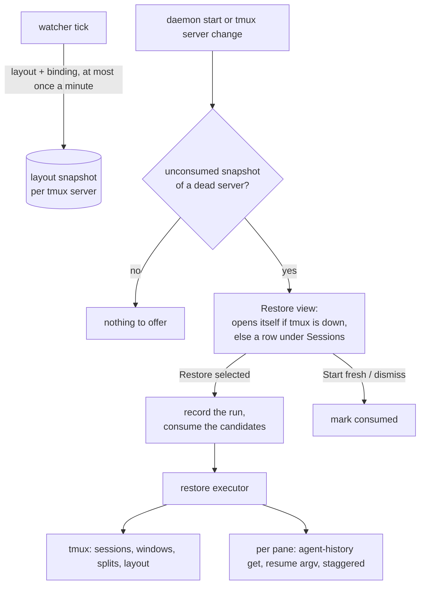

# Restoring the workspace after a reboot

Status: **design, P1 in review.** The recorder (#439) and the executor with its view
(#440) implement P1, simplified in places their PRs list; this note stays the target.
Step zero, starting a tmux session from the phone when none exists (the "Start a tmux
session" empty state), was built separately. This note designs what comes next: bringing
back the workspace that was running before the tmux server went away.

## Problem

A tmux server is one process holding every session, window and pane. A reboot, a crash,
an OOM kill or a stray `kill-server` takes all of it, including the coding agents. Their
conversations survive, since each harness keeps its transcript on disk, but the
workspace does not: which agents ran where, arranged how, and which of them mattered.

On 2026-09-30 an agent cleaning up a throwaway demo killed the user's main tmux server
(AGENTS.md, "Never kill the user's tmux server"): 47 panes, 29 Claude Code, 14 Codex, and
shells. Recovery meant searching `~/.claude/projects` and `~/.codex/sessions` through
agent-history and resuming sessions one at a time into windows rebuilt by hand. Two
lessons. The information needed already existed, scattered across the harnesses' session
stores, but nothing tied it to the layout it came from. And not everything should have
come back: some sessions were days stale or finished, and resuming them added noise the
user then had to prune again.

The daemon is in the right place to fix both. It watches every pane, knows each pane's
tool and when it last changed, can learn through agent-history which conversation a pane
holds, and keeps running when tmux does not.

### A second loss, restored by hand

On 2026-10-13 the machine rebooted with one small session of five panes: three Claude
Code agents and two shells. An agent restored it by hand, from what the daemon had left
in `history.sqlite3`. It worked, narrowly, and each step that nearly didn't is now a
requirement below.

- **The data survived by luck of timing.** The daemon came back with the machine, but it
  prunes checkpoints only on its first sight of a tmux server. While no tmux ran, the
  dead server's rows sat intact for three hours; the moment a server started, they were
  gone. A terminal profile or login script that starts tmux would have erased them
  before anyone looked. Hence retention by consent, not by sight (*Retention*).
- **The activity clock lied about staleness.** Two agents' checkpoints said "active
  yesterday"; their transcripts had been idle for four days. Screen churn, not work,
  moved the clock. Hence staleness from the transcript (*Defaults*).
- **The death time was four days early.** The inventory's last-seen stamp had stopped
  advancing days before the reboot, while the daemon ran without a break: one pane's
  parse failed during a network blip, and every tick after that skipped history until
  the pane's screen next changed, which an idle agent's never did. Panes opened after
  that were never recorded at all. Hence a last-seen stamp that does not depend on
  parsing (*The new record*).
- **Matching panes to conversations after the fact was guesswork.** Pane titles are not
  in transcripts, and agent-history's search by title returned unrelated sessions. What
  worked was directory plus each transcript's last write; what confirmed it was the
  saved card's cost matching the resumed session's to the cent. One pane had no card at
  all and was placed only because its transcript was last written at shutdown, alongside
  the other two. Hence binding while live, and those two signals (*Binding*, *The
  Restore card*).
- **Consent has to hold for agents too.** The user asked an agent to "try" a restore; it
  started the tmux server and three agents without confirming. That is the unattended
  restore this design forbids, reached through a loose request (*Safety*).

What went smoothly validates the mechanics: a server started in its own systemd scope,
as step zero does, and each resume typed into a shell, which survives the agent exiting.

### A third, restored through the card

On 2026-10-14 another reboot was the first field test of the executor and its card. Two
findings changed the design.

- **The index was days stale.** agent-history's index is refreshed by Claude Code's hook
  and by a reconciliation every few hours; on that machine the hook was not installed,
  so sessions from that morning read as days idle, or were missing. Building the offer
  therefore reconciles the index first (about a second cold), so every pane is judged on
  its transcript's latest state rather than whenever the index last caught up.
- **The card contradicted its own ticks.** It showed each pane's idle time from the
  screen clock while the default read the transcript, so a pane could read as idle
  a few minutes and still come up unticked as stale. The idle time shown is the transcript's, the same one the
  default reads: what the card says is the reason for what it ticks.

## Goals and non-goals

Goals:

- **Restore the layout:** sessions, windows, pane order and geometry, names, and each
  pane's working directory.
- **Restore agents into their conversations** by running the harness's resume command for
  the session the pane held. Re-running the original command line starts a blank one.
- **Don't resume what is stale or finished.** The user chooses; defaults informed by
  recency make the common case one tap.
- **One mechanism for every cause:** reboot, tmux crash, accidental `kill-server`.
- **Serve hosted boxes too**, which reboot, or outlive their suspend limit, the same way.

Non-goals:

- **Reviving processes.** Memory is gone. We restore conversations, which harnesses keep
  on disk, and places, which are directories. No CRIU-style checkpointing.
- **Re-running arbitrary programs.** `make deploy`, `vim` or `tail -f` come back as a shell
  in the right directory with a note saying what ran there. Replaying an unknown command
  line is how a restore deploys twice.
- **Screen contents.** The transcript is the durable record; the resumed harness redraws it.
- **Unattended restore.** Nothing comes back without a person's say-so. Autostart for
  declared long-running agents is a later, per-agent opt-in.

## What to snapshot

### What is recorded today, and why it is not enough

`history.sqlite3` ([pane-history.md](pane-history.md)) holds two relevant things.

- **Inventory intervals** record, per pane, a key (tmux server id, pane id, pane pid), the
  session name, tool, folded state and sub-agent counts. No window index, pane order,
  layout, directory or title. They exist to draw the fleet chart, and adding layout would
  turn a deduplicated, rarely changing payload into one that changes on every resize.
- **Pane checkpoints** ([activity-clock-persistence.md](activity-clock-persistence.md))
  hold each pane's activity clocks and last card. They are the right *signal* for
  staleness but the wrong *store*: they are pruned once their tmux server is provably
  gone, and after a reboot the first tick that sees any new server does exactly that,
  including the server the empty-state button just started, or one a login script started
  before anyone looked. An offer built on them would vanish the moment the user opened a
  fresh shell. Until the snapshot below takes over as the restore record, a dead server's
  checkpoints are kept for 30 days instead of pruned on sight, so a manual restore has
  something to read. The first PR leaves that in place: a snapshot covers only servers
  that ran after it shipped.

Everything else is already read on every tick: `list-panes` returns session, window index
and name, pane index, current path, current command, title and pid. Missing are a few more format fields (the window's
tmux id, the session's group and creation path, the window's layout string, zoom flag and
automatic-rename setting) and the agent session binding.

### The new record: one layout snapshot per tmux server

One row per tmux server, replaced in place: current state, not history, like the
checkpoint table. It holds each session (name, creation directory, its session group,
if any, and its window links: which window ids it shows, at which index, and which one is
current in it); each window (tmux window id, name, whether that name was set by hand or
by tmux's automatic renaming, tmux layout string, zoomed); and each
pane (index, active, directory, title, classified tool, the basename of the program in
its foreground (never its arguments), and for agents the **binding**: harness, session
id, and the session's last-message time when the server was last seen). Each pane also carries a **copy** of its last
activity time, coarse to the minute, its classified state as the watcher reports it
(`activity` and, for a wait, `waiting_on`), and the cost and context its card last
showed. The card's defaults, its binding check and the launch order read these, and a
timestamp alone cannot recover them once the server is gone. They normalize
it one way: `running` and `compacting` are working; `waiting` on the user is waiting on
the user; a wait on something external, `idle` and `unknown` are judged by recency
alone. The copy keeps the snapshot meaningful
after checkpoints are pruned; the coarseness keeps it from rewriting on every keystroke.

The current window is a property of the link, not the window: one window linked into two
sessions can be current in one and not the other, so a single flag on the shared window
would lose one session's focus.

**Grouped sessions** share their windows, and `list-panes -a` reports a shared pane once
per member; the watcher already folds those copies into one. The snapshot does the same:
each shared window and its panes are stored once, and every member keeps its own
session record (creation directory, links, current window). Restore builds the windows
once and creates the other members as members of that group, then restores each member's
own current window, so a shared agent is never resumed twice and no member loses its
focus. What is deduplicated is the windows, never the sessions. **Linked windows**
(`link-window`) are the same sharing without a group: `list-panes -a` again repeats the
pane, but `session_group` is empty. So windows are keyed by their tmux id, each session
records which window ids it shows at which index, and restore builds a shared window once
and links it into the other sessions. Folding by pane id alone would lose the second
session's link, and keeping both copies would resume the agent twice.

**Server identity** is the boot id plus the server's pid *and its process start time*.
History keys on boot id plus pid, and there a reused pid only keeps a dead server's rows
a little longer. Here it would be worse: a later server that drew the same pid in the
same boot would overwrite the only restore candidate, and an unrelated process holding
that pid would make a dead server look alive and suppress the offer. The start time
(field 22 of `/proc/<pid>/stat`, the check agent-history already makes for Claude's
registry) closes both.

The payload is rewritten only when it changes. Its **last-seen** stamp is refreshed every
minute regardless, the cadence the inventory heartbeat already keeps, because it is the
proxy for when the server died: an unchanged server can run for days, and staleness must
be measured from its end, not from its last layout change. That refresh must not ride on
the inventory write: the inventory used to skip any tick with a pane whose screen went
unread, and one such pane froze its stamp for days (above). The snapshot refreshes last-seen on
every successful `list-panes`, whatever the classifier made of the screens. Fifty panes are a few tens of
kilobytes; the cost is one small update a minute.

**Retention.** When a server dies its row stays as the restore candidate, stamped with
when it was last seen. Every unconsumed one is a restore candidate (below); every row,
consumed or not, is dropped after 30 days (except one an unfinished restore run still
reads, which waits for the run), enough to get back from a long weekend. Unlike inventory intervals
they are not kept forever, because nobody restores a month-old layout. A new server
appearing never removes one; that is the checkpoint table's failure (above). A **consumed**
mark (restored or dismissed) keeps the offer from reappearing until then.

### Binding a pane to its conversation

This is what resurrect-style tools cannot do, and the only part needing new plumbing.
agent-history already computes the binding to stop a second copy of a running session:
it reads Claude Code's process registry, which records each live session's pid and tmux
pane, and for Codex and omp the transcript files their processes hold open. Live Mode's
`resume_session` uses it, and also checks that the agent's pid descends from the pane's
process, since a pane id from another server would otherwise match by accident.
Today `get` and the running check look a session up by bare id, harness by harness; two
harnesses can share an id, so the new listing, `get` and the running check all take and
validate the pair (harness, session id). Live Mode's `resume_session` moves with them,
since it calls `get`: its tool schema, consent lookup, audit and reservation key carry the
pair too, in the same first PR.

The snapshot needs the inverse, every live session with its pane, in one call: a listing
in agent-history in the shape `get` already returns. The daemon calls it once a minute,
not per tick. The listing also writes each live session's index entry: today an entry
exists only once a hook or reconciliation has run, which a session started shortly
before a crash may never have had, and restore can only `get` what is indexed. The ancestry check proves a session belongs to this server, not that it
occupies the pane: a pane can hold a stopped background agent under a foreground one. So
a pane is bound only to the one listed session whose process is in the pane's foreground
process group (the terminal's `tpgid` in `/proc/<pane pid>/stat`); with none or several,
it stays unbound rather than guessing. The last good binding is cached per pane together
with that process's pid and start time, and dropped when the foreground process changes,
so a swap never carries the old conversation forward. Codex sessions behind the shared
app-server have no pane (agent-history's README explains why); for them the watcher falls
back to the status-bar `session-id` match Live Mode already uses ([agent-setup](../agent-setup.md)).
A pane left without a binding (a Codex pane with neither, or any agent pane whose
foreground was ambiguous) stays *unbound*: restore still knows its tool and directory
and offers a picker of that directory's recent sessions instead of guessing. Neither
`resolve` (which needs a query) nor `get` (a known id) can fill it, so agent-history
gains a second listing: one tool's indexed sessions whose `cwd` is a given directory,
newest first, in the shape `get` returns, with the transcript's last write.
The picker ranks first the sessions whose transcript was last written within a minute of
the server's death: a harness flushes on shutdown, so those were almost certainly live.

A binding is dropped when the agent exits and the pane returns to a shell. An agent the
user closed is finished by definition.

## Detecting that a restore is due

The daemon cannot see a reboot, only what one leaves behind. Its candidates are the
unconsumed snapshots of dead servers, newest first. Rows of running servers are skipped:
a replacement server has usually written its own, newer row by the time anyone looks, and
it must not hide the dead one behind it. Recency alone does not choose among the rest: a
server a login script started after the reboot, dying before anyone opened the card,
would be the newest loss and bury the reboot's. So the card leads with the newest and
lists the others (when each was last seen, and its pane count) for the user to pick.
Restoring one or dismissing the card consumes every candidate it listed, the ones not
picked as dismissed, so none resurfaces once the user has seen them all. A server is judged by comparing its identity with the
present:

- **Boot id differs** (`/proc/sys/kernel/random/boot_id`): the machine rebooted.
- **Same boot, server process gone:** tmux crashed or was killed.
- **That server still alive:** skip it. This is what keeps a daemon restart,
  which every integration deploy causes, from looking like a lost workspace.

Both loss cases get the same offer, worded differently. The offer does **not** require
tmux to be absent: many setups start a session at login, so after a reboot there is often
a fresh server with one shell, and an offer tied to the empty state would never show.
Where the offer appears is the next section's.

### The Restore card

**The card is a view of its own** (`#view=restore`, beside the dashboard's other views),
not something pushed into an existing screen. It opens itself when the bare app (no pane
or view chosen) loads with an offer and no tmux running. A row under Sessions, naming the
count, reopens it until the offer is restored or dismissed, and closes it once it is.
Back or Dashboard shows the dashboard untouched. The user wants to see the unadulterated
dashboard before deciding, and both earlier placements shoehorned the offer into a screen
that belongs to something else. As a card at the top of the list, on every width, it sat
under a search box and filters that meant nothing to it. As the dashboard's empty state
on the wide layout, the empty dashboard around it read as broken. A view of its own
leaves both screens as they are, and the row keeps the offer one tap away.

The card groups the snapshot as tmux did: sessions, windows, panes. Each pane shows its
tool icon, title, directory and how long it had been idle when the server died, with a
checkbox; sessions and windows have tri-state checkboxes over their panes.

A shared (grouped or linked) window appears under every session that shows it, but its
panes have one selection each, because the run restores a pane once. Its checkboxes are
therefore one state drawn in several places: ticking a shared pane under one session
ticks it under all of them, and each session's tri-state reads the same pane states. A
session is restored when any pane it shows is selected, with all its links to restored
windows, so indexes come back for every member that shared them, and focus does
wherever its target was restored (below).

**Defaults decide whether a restore is one tap or forty.** A pane is checked when its
agent was working, waiting on the user, or active in the last 24 hours; unchecked when
idle longer, or a shell with nothing running. Staleness is measured **from when the
server died, not from now**: a machine powered off all weekend should still treat Friday
afternoon's work as recent. For an agent pane, "active" means the transcript's last
user or assistant message, a new agent-history field (`last_message`), as the snapshot
saved it: read after the loss, a conversation the user resumed and finished by hand would
look freshly active. The existing
`last_active` is not it and stays as it is: it moves with every transcript record, tool
output and bookkeeping included, the same false recency again. Nor is it the checkpoint's activity clock: the clock moves with
anything on screen, and in the field it showed four-day-idle agents as active yesterday.
The clock remains the measure for shells and for agents with no binding. Whichever time a
pane's default reads is also the idle time the card shows beside it, so the card never
argues with its own ticks (the 2026-10-14 finding above).

Panes that cannot be restored are shown disabled, with the reason: the directory is gone;
the transcript is gone (checked on disk by `get` and the listing, at card and again at
launch time, since the index's `source_missing` is only as fresh as its last
reconciliation; a check that cannot run leaves the pane disabled as "history unavailable,
retry", not as gone); or the session is already
running, say because the user resumed it by hand, using the same running check as Live Mode's
resume; or whether it is running cannot be established (agent-history's
`running_unknown`). Live Mode's resume refuses that last case rather than risk two processes
writing one transcript, so the card must not offer a restore the executor would reject.

Each agent pane also shows the cost and context its card last displayed (the snapshot's
copy). A resumed
harness reports the same figures, so a mismatch after restore is a cheap check that the
binding pointed at the wrong conversation, worth a warning on the pane.

**Restore selected** states the count ("Restore 11 agents in 4 sessions"). **Start
fresh** consumes the listed candidates and, when no tmux server is running, hands off to the
empty state's "Start a tmux session". When a replacement server is already up, the fresh
workspace already exists, so the same action reads **Keep current** and only consumes them. Starting yet another session there would be no equivalent. Sessions are collapsible groups, open by
default: the view has the screen to itself, and the panes are what the user is deciding on.

## Restore mechanics

### Building the layout

The executor does what a person would. For each selected session, in snapshot order, it
creates the session in its saved creation directory, which tmux keeps as the default for
later windows (or, if that directory is gone, in the first selected pane's validated
directory, which the card notes), respawns the first pane into that pane's own directory,
moves that first window to its saved index (`new-session` puts it at tmux's `base-index`),
adds each further window at its original index, splits off the window's panes in order, each in its own directory, then
applies the saved layout string for exact geometry. A deselected pane makes the layout
string's pane count wrong and tmux rejects it, so that window falls back to the nearest
built-in layout rather than failing. Names, the active window and pane, and zoom go last.
A saved current window or active pane that was deselected was never built, so focus falls
back deterministically: the session's lowest-index restored window, and that window's
first restored pane.
A window whose name was set by hand gets automatic renaming turned off before its name is
applied; otherwise tmux renames it after the agent's process the moment it starts (the
[orchestration notes](../agent-orchestration.md) describe the same clobbering). Windows
that were auto-named stay that way.

A session name that already exists (a login script's, typically) is never merged into;
the restored session gets a suffix, because a restore that rearranges a live session is
worse than an ugly name. A pane whose directory has moved is skipped and reported, never
started in `$HOME`: an agent resumed in the wrong directory cannot find its session.

### Who owns the new server

A constraint shared with step zero. The daemon is a systemd user unit whose kill mode is
the whole control group, and a tmux server it forks lives in that group. Every
integration deploy restarts the daemon, so a server started the obvious way would be
killed, restored agents and all, on the next deploy: the incident again. The server must
start in its own scope or unit.

It also must not inherit the unit's deliberately minimal PATH, under which an
nvm-installed `claude` does not resolve. Every pane starts as the user's login shell in
its directory, and an agent's resume is typed into that shell, as the hand restore did:
PATH comes from the user's profile, and when the agent exits, normally or at once, the
pane survives as a shell instead of closing and taking its place in the layout with it.
The typed line is agent-history's `resume_argv` shell-quoted word by word, so nothing in
it is interpreted as shell syntax, the promise `resume_argv` makes.

### Per pane

- **Agent panes** run the bound session's resume argv, fetched fresh from agent-history at
  restore time and gated by the daemon's known-resumable list, so nothing from the
  snapshot beyond a session id and an account dir reaches a command line. It runs on the
  account the agent ran on, through the same `accounts.command` wrapper Move uses
  (`env CLAUDE_CONFIG_DIR=<dir>`, or `env -u` for the default dir). That account is
  recorded, not derived: a Move copies the transcript, so the id lives in two dirs, and
  agent-history's `source` may name the older copy. Deriving it once resumed a moved
  session on the wrong account, from its stale transcript, without a word. So the recorder
  reads each agent's `CLAUDE_CONFIG_DIR` / `CODEX_HOME` from its own `/proc` environment
  (the variable alone, as plan usage does), and restore checks the conversation is still in
  that dir. If it is gone there but exactly one other account holds it, the card offers the
  pane unticked with a note naming that account, so resuming elsewhere is a choice the user
  makes; with none or several, the pane is blocked. Nothing falls back to the default dir
  unasked. Each session's own account default (`tmux set-environment`) is recorded too and
  set again on the rebuilt session, so its new windows open where they did. Snapshots from
  before this carry no account and keep deriving it from `source`. The argv comes paired with the
  index entry's `cwd`, which is where it must run, and restore validates that directory
  as Live Mode's resume does. When it differs from the snapshot's pane directory (the
  agent changed directory mid-session), the index wins, because only there can the
  harness find the conversation; the card shows the indexed directory. The index produces `claude
  --resume <id>`, `codex resume <id>` and `omp --resume <id>` today. OpenCode and Gemini
  have no reader yet; their panes return as shells in the right directory with a note
  naming the tool. Resume restores the conversation, not launch flags: a pane started as
  "Claude (Fable)" returns on the default model. Accepted, because permission flags in
  particular should not survive a reboot silently.
- **Shell panes** get the user's shell in the saved directory.
- **Anything else** gets a shell there, with a one-line hint naming what used to run. The
  program is never re-run.

### Pacing, failures, idempotency

Agents start **a few at a time** (three by default), each counted as started only when it
reaches its input line or a first-run prompt, as the
[orchestration notes](../agent-orchestration.md) learned the hard way. Forty Node
processes at once fight for CPU and memory on a just-booted machine and hit the
provider's session-start rate limits together. Order: panes waiting on the user, then
working, then by recency. The layout is built up front, so every pane exists at once and
agents fill in as their turn comes. Readiness has a bound, about a minute: an agent that
is still alive but has shown neither its input line nor a recognized prompt by then is
marked as needing attention, and its slot passes to the next one, so a few hung starts
do not stall the rest of the queue (six can; see below). The timed-out process is still alive, though, so
slots alone would let repeated hangs pile up processes without bound. A second, hard cap
counts every live agent that has not reached a prompt, timed out or not (six, twice the
pace): at the cap the queue waits until one becomes ready or exits. The executor never
kills a timed-out start, since a slow first run is indistinguishable from a hung one. So
six hung starts pause the restore: the card says so, names them, and the queue resumes
when the user closes one (or it comes alive). A paused restore costs a tap; a killed
first run could cost a login or a half-written config.

An agent that exits at once stays in the layout as the shell its launcher falls back to,
with the error above the prompt, and the card reports it. A login or first-run prompt is
different: the agent is alive and waiting, so no shell can take over. That pane stays as
it is, counts as started (it reached a prompt, which frees its slot), and is marked as
needing attention, because a login is a human boundary anyway. No retries.

**Idempotency** rests on a durable restore run, started in two steps so that no
restorable target ever exists before the run can name the server it lives on. First, in
one transaction, the daemon records the run (the exact selection, each selected pane
pending, and the actor and confirmation tier of the tap that started it, since the
request that carried them is gone after a daemon restart and every deferred launch is
still audited with them) and consumes every candidate the card listed: the picked one *by
that run*, the rest as dismissed, so a crash cannot let them resurface. A dismissal
consumes them all with no run. A second tap or device is therefore told a restore is running. Second, it records
the destination server's identity (the same boot id, pid and start time) on the run.
With a replacement server up, that is the live one. With none, the daemon first starts
a server holding a single empty session named after the run, records that server's
identity, and only then builds anything; the holder closes once the first restored
session exists, or when the run ends having restored none (every pane failed its
checks), so a failed restore leaves no empty workspace behind. A crash between the two steps leaves a run with no destination: recovery
adopts the live server that holds the run's holder session, or else starts one as above.
Nothing it built can be orphaned, because nothing is built before the identity is
recorded. Layout construction is
recorded too, and a tmux command and a database write cannot be one transaction, so
the order matters. Before each mutation the run records its intent (which snapshot
object it is about to create), and the creating tmux command list also tags the new
object with a user option naming the run and that object. Afterwards its tmux id and,
for a pane, its launch outcome (pid, or the failure) are written to the run. A crash
between the mutation and that write loses only the id: recovery finds the object by its
tag rather than creating it again beside the first. A window link (`link-window`) is
a relation, not an object, so it carries no tag of its own: recovery checks whether the
tagged window already sits at its saved index in the tagged session, and links it only if
not. A launch is different: an agent that
started and already exited leaves nothing to find. So before each launch the run
records the attempt, and recovery treats an attempt with no outcome as indeterminate: the
pane is marked on the card for a manual retry, never launched again unconfirmed. tmux ids are only unique within one server, and a replacement server reuses them,
so all of it is scoped to that destination identity. A daemon that restarts mid-restore
finds the unfinished run. If its destination server is still alive, it reconciles the run
against tmux by those ids and tags (reusing every target that still exists, rather than meeting its own half
built session as a name collision and suffixing it), creates what is missing, and
launches what is pending. If that server died too, its ids and launch outcomes describe
objects that no longer exist: they are discarded, every selected pane returns to pending
(the running check below still skips what is live), and the run continues against the
current server under its new identity, recording the dead one as abandoned. The snapshot records each object's run tag with
the rest of the inventory, so the mark outlives the server. In the dead destination's own
snapshot the objects tagged by this unfinished run are its half-built copy, which it is
rebuilding: they are never offered, and stay excluded after the run finishes, since the
run records every destination it abandoned. Only on the destination it finished on do its
tags stop meaning anything: what it restored there is ordinary workspace, offered like
any other if that server is lost later. Untagged sessions in it (a replacement server's own, or ones
resumed by hand) remain a candidate of their own; a snapshot with none is consumed by the
run in the same step. An object created after the last snapshot refresh is in no
snapshot, so it has nothing to exclude.
The audit trail is not this record: it is telemetry, for reconstruction afterwards,
not state an executor can resume from. And right before each launch the running check
runs again, so a session resumed by hand meanwhile is skipped. That check and its lock
come from Live Mode's `resume_session`, which today always opens a new window. They move into
one shared primitive, "start this session in this pane unless it is already running",
that takes a target pane: Live Mode passes a pane it just opened, restore passes the prebuilt
one, whose shell the primitive types the launch into. One path, not two.
The reservation's lifetime changes with it. Live Mode's holds a session while the pane's
pid is the one it launched, which works because its window runs the agent directly, so
that pid dies with the agent. Under restore's launcher the pane's pid is the shell that
outlives the agent, and that test would block every later resume or retry of a session
whose launch failed. So the primitive holds the reservation through startup and releases
it when the agent process exits or its launch fails, not when the pane goes away.

**Audit.** Each launch writes a record of an explicit allowlist: actor, harness, session id,
pane id and an outcome code. It is not Live Mode's resume record, which also carries window
and session names, the directory and free-text failure detail, all private here (below);
the session id leads back to them. The restore writes one record of the selection, by id.

## Safety

**Restoring launches agents, and agents act.** A resumed Claude Code or Codex session
waits for input rather than continuing its last turn, but harnesses can be configured to
approve on their own (auto mode, bypass settings), and a person may start a restore and
walk away. So restore is an explicit, confirmed action whose button states the count, and
the daemon never restores anything on its own, not even "just the layout": a daemon that
rebuilds unprompted will one day rebuild the wrong thing. The same holds for an agent
asked to "restore my workspace": it opens the Restore card, or lists what it would start
and waits, rather than starting a server and resuming sessions on a loose request. In
the field one did exactly that, and the prune it triggered destroyed the evidence it
had just read.

**No command line or environment is persisted.** The snapshot stores directories, titles,
tool names and session ids: never a pane's command line, `/proc` cmdline or environment,
any of which can carry a token typed inline. The one exception is the account dir above,
read as two named variables with every other one dropped unread: a path, which the
accounts list already shows. The resume command is rebuilt from the index
at restore time. The user-controlled text it does keep cannot be ruled out: titles are
agent-chosen, and session and window names and directory paths are whatever the user
typed, so any of them could hold a secret. They are kept because the card needs them to be
recognizable, so they are stored only where all history is (a `0700` directory with
`0600` files) and shown only on the user's own Restore card, and they are never written to
logs or telemetry.

**Permissions do not come back on their own.** Resume argv carries no permission flags,
so an agent launched with skip-permissions returns in its harness's configured default.
If the user's own settings default to an auto mode, the agent runs that way: their
standing configuration, accepted at the confirm step.

**Sessions resumed elsewhere.** The running check sees this host's processes, so a
transcript an IDE or a hand-typed resume holds open is not restored twice. It cannot see
another machine; hosted boxes keep transcripts on their own disk, so that case does not
arise here.

## Alternatives considered

**tmux-resurrect with continuum.** Resurrect saves the layout half (sessions, windows,
panes, layout strings, directories, optionally contents); continuum saves on a timer and
can auto-restore when tmux starts. Its program restore re-runs a saved command line from
an allowlist, which for a coding agent means a blank conversation: the conversation lives
in the harness's store, not the command line. The usual workaround maps `claude` to
`claude --continue`, which resumes the *most recent* conversation in the directory, so
with several agents per repository, the normal case here, every pane resumes the same
one. No staleness, no phone UI, and auto-restore without asking. The daemon already reads
everything resurrect saves, so adopting it adds a second, plugin-private record and still
lacks the hard part. We take its technique (replay the layout string), not the tool.

**A systemd user unit per agent.** Agents need a terminal and a person, so they would
still run inside tmux; a unit per short-lived agent is heavy, and restarting them
unattended is what we rejected. Right only for declared long-running agents: phase
three's manifest autostart.

**Make reboots rarer.** Lingering is on, and tmux in its own unit (needed anyway, above)
survives logouts and daemon restarts. Worth having, but kernel updates, power loss and
the `kill-server` that started this still happen. Fewer losses still need recovery.

**Hosted boxes with suspend.** Suspend keeps RAM, so tmux survives, and the hosted-box plan
makes it the default for idle boxes. But suspension has a time cap, some machine shapes lack it, and a
workstation has none. A box past the cap reboots and needs exactly this. Suspend makes
restore rarer; it doesn't replace it.

**CRIU-style process checkpointing.** Fragile with open connections to model APIs, and
unnecessary when the harness already wrote the conversation to disk.

**Auto-restore everything.** The simplest UI; the incident is the argument against it.

## How this meshes with openbus

The hosted-box plan asks three contracts of it.

- **Event envelope.** Identity is the agent session, the pane its current location. The
  snapshot's durable key for an agent pane is likewise the harness session id, and each
  restored pane emits a `resumed` lifecycle event.
- **Audited action path.** "Resume" is a verb in the action vocabulary; restore is that
  verb many times over, through the one path that records actor and confirmation tier.
  The card's confirm button is the tier.
- **Agent manifest.** Grown from `TMUXRC_LAUNCHERS`, it carries a restart and resume
  policy. A manifest agent marked `autostart` is the one sanctioned exception to "never
  without consent", in phase three; everything else stays an offer.

Cross-agent connect ([#308](https://github.com/querystory/tmux-rc/pull/308)) stores grants
by harness session id so they survive a resume: a restored session keeps its grants, and a
new agent in a recycled pane id does not inherit them.

## Phased plan

- **P0 (shipped):** start a tmux session from the phone when none exists. It brought the
  empty state and session creation, and meets the server-ownership and PATH constraints
  above.
- **P1 (in review, #439 and #440):** snapshot and binding, detection, the Restore view
  with defaults, the paced executor.
- **P2: smarter defaults.** A pane whose PR merged is finished
  ([pr-association-lifecycle.md](pr-association-lifecycle.md)); a pane the user was
  viewing is active. OpenCode
  and Gemini resume as agent-history gains readers.
- **P3: hosted boxes.** Manifest autostart, restore as the fallback after a suspend past
  its cap, surfaced as a box-level attention item.

### The first PR

It records snapshots and restores nothing. A snapshot helps only if it was being written
*before* the next lost server, which is not scheduled. Shipping the recorder first means
the restore half lands with real data from the user's own fleet to test against.

Scope: the snapshot table (a new schema migration), the new fields in the pane listing
(window id, session group, session path, window layout, zoom, automatic rename; the
foreground program is the `pane_current_command` already read, stored as a basename),
agent-history's live-session listing (which indexes what it lists) and last-message time,
the once-a-minute binding, the consumed mark, and a read-only endpoint returning the
unconsumed dead-server snapshots with each pane's
computed default, so the card's data can be checked by hand before the card exists.
With `TMUXRC_TARGET` set, the watcher lists only its one pane and agent-history features
are off, so the recorder does not run and leaves any existing row untouched: a one-pane
view must never replace a server's full snapshot.

Acceptance:

- Against an isolated test tmux server (its own socket, as the existing tmux tests do,
  never the user's), the snapshot reproduces sessions, window indexes, names, layout
  strings, zoom, rename settings, pane order and directories exactly.
- Bound Claude, Codex and omp panes record the session id agent-history reports; an
  unbound Codex pane records tool and directory with no id.
- A session never indexed before (no hook run, no reconciliation) can be fetched with
  `get` after one listing and after its server is gone.
- Transcript records that are not user or assistant messages leave the last-message time,
  and so a pane's default, unchanged.
- An unchanged fleet rewrites no payload, only the minute last-seen stamp; resizing a
  pane rewrites it once.
- A pane whose parse keeps failing does not stop the last-seen stamp, and a pane opened
  meanwhile still enters the snapshot.
- After the test server is stopped by its own socket, the endpoint returns its snapshot as
  a candidate, even after a second test server has written a newer row; a daemon restart
  with the server alive returns none.
- Grouped sessions record each shared window once, with every member's own session
  record and current window; a window linked into two ungrouped sessions is recorded once,
  with both sessions' links, indexes and current-window flags (current in one, not the
  other). Rebuilding and relinking from that record is the executor's test, later.
- A pane holding a stopped background agent under a foreground one binds to the
  foreground one; a pane where no or several listed sessions are in the foreground stays
  unbound.
- A server identity whose pid now belongs to a different process (a different start
  time) counts as dead, and a new server reusing a dead one's pid gets its own row.
- A new tmux server appearing does not delete the previous server's snapshot, the
  checkpoint table's failure mode.
- No command line, cmdline or environment value reaches the database; a test asserts it
  against a pane started with a secret-looking argument.
- `make test lint` passes.
